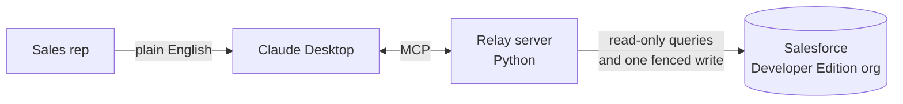
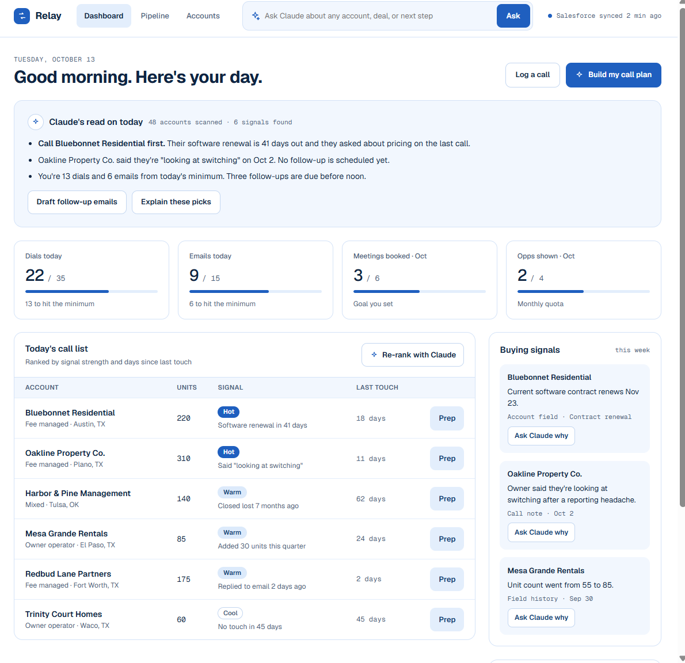
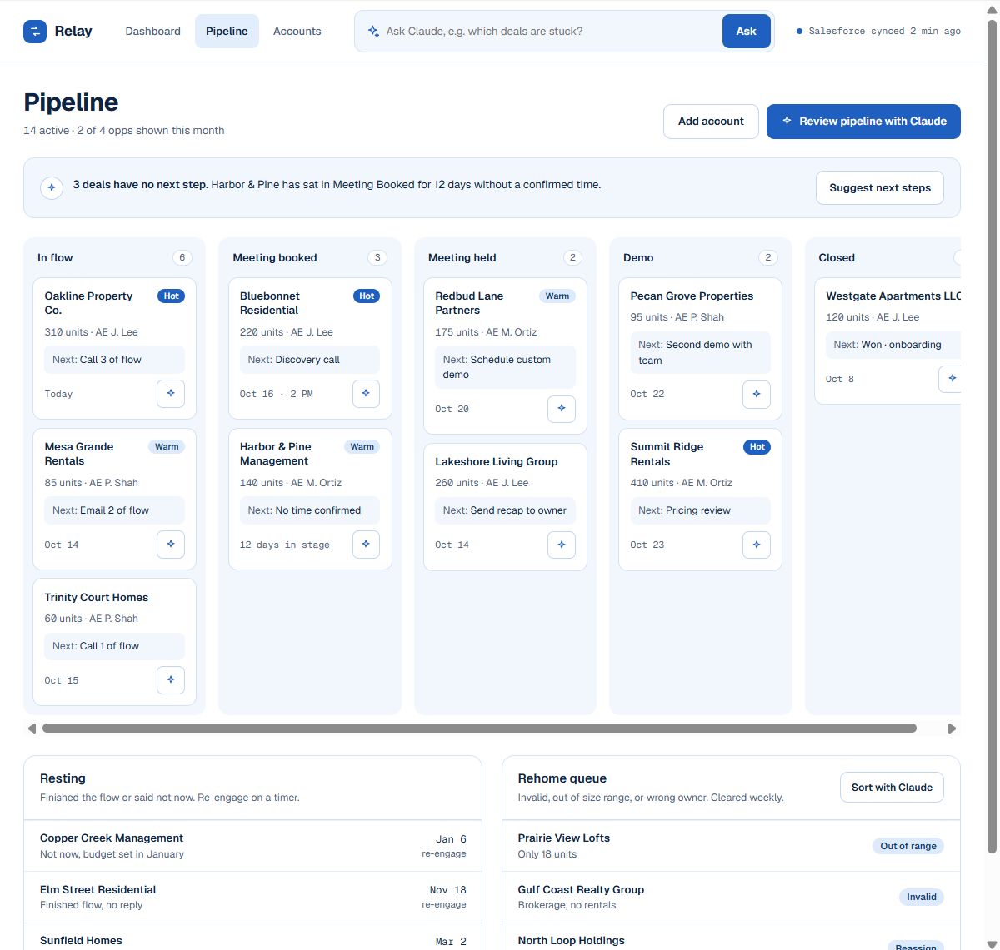
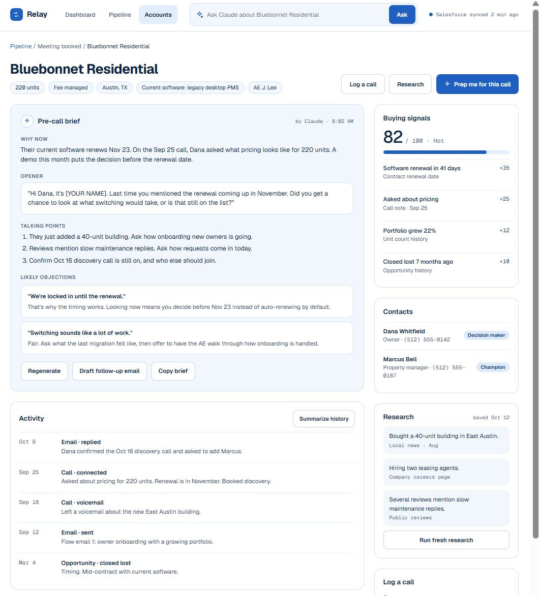

# Relay

[](https://github.com/SahilH-spec/relay-crm-mcp/actions/workflows/ci.yml)

**Ask Claude about your Salesforce accounts in plain English. Relay is an MCP server that gives Claude safe access to account details, open deals, and call history, so a sales rep can skip the clicking.**

> All data is fictional and generated by the seed script. Relay is an independent portfolio project. It is not affiliated with, endorsed by, or built from the data of any employer.

## What it is

MCP (Model Context Protocol) is a standard way to connect an AI assistant like Claude to outside tools and data. Relay uses it to connect Claude Desktop to a Salesforce org.

A rep can ask things like:

- *"Who should I call today, and what happened last time?"*
- *"Summarize the Maple Ridge account before my call."*
- *"Find my Tier 1 accounts renewing in the next 60 days."*
- *"Log a note on that account: spoke with the owner, wants a demo next week."*

Relay includes a seed script that fills a free Salesforce Developer Edition org with 50 fictional accounts, so the whole project can be tried without touching real data.

## Purpose

A rep's day is spent answering questions that live across several Salesforce records: what is this account, what is open, what happened on the last call, and is something about to expire. Relay turns those lookups into one question in plain English, and flags things worth acting on, like "renewal in 38 days."

## How it works



1. You ask Claude a question.
2. Claude picks a Relay tool and calls it locally. Nothing is exposed to the network.
3. Relay checks the input, queries Salesforce, and returns tidy data.
4. Claude turns it into a short briefing.

## The five tools

| Tool | Type | What it does |
|---|---|---|
| `check_salesforce_connection` | Read | Confirms the connection works and lists any setup still missing |
| `find_account` | Read | Searches accounts by name, status, tier, portfolio type, size, or renewal window |
| `summarize_account` | Read | One-call briefing: details, contacts, deals, call history, and signals like "renewal soon" or "long idle" |
| `list_open_deals` | Read | Open deals, soonest close date first, with a pipeline total and per-stage breakdown |
| `log_note` | **Write** | Logs a call note on an account. The only write Relay can do |

## Safety by design

- **One narrow write.** `log_note` can only create a note, and it refuses any account that is not demo data. Relay never edits or deletes existing records.
- **Secrets stay local.** Credentials live only in a git-ignored `.env` file and are never printed or sent to Claude.
- **Injection-safe queries.** Every value that reaches a Salesforce query is escaped and validated.
- **Readable failures.** Expected problems come back as clear messages so Claude can tell you what to fix.

## Roadmap: web workspace

Next is a small web workspace on the same data: a daily call list, a pipeline board, and an account page with a pre-call brief. These are **design mockups with sample data, not a working app yet.**

| Dashboard | Pipeline | Account prep |
|---|---|---|
|  |  |  |

## Tech at a glance

| Area | Tools |
|---|---|
| Server | Python, MCP over stdio |
| Salesforce | REST API, OAuth 2.0 Client Credentials |
| Tooling | `uv`, `pytest` (62 tests, run offline), `ruff` |
| Client | Claude Desktop |

## Quick start

You need a free [Salesforce Developer Edition](https://developer.salesforce.com/signup) org, [uv](https://docs.astral.sh/uv/), and Claude Desktop.

```powershell
uv sync
Copy-Item .env.example .env   # fill in the three Salesforce values
uv run relay-check            # should end with all [ok]
uv run pytest                 # 62 tests, no Salesforce needed
uv run relay-seed             # load the 50 fictional accounts
```

Then add Relay to Claude Desktop and ask: *"Check my Salesforce connection."*

## More detail

Full technical breakdown (Salesforce setup, custom fields, Claude Desktop config, seed options, security details, project structure): [docs/TECHNICAL.md](docs/TECHNICAL.md)

## Known limits

- Built and tested against a Developer Edition org with fictional data, not a production org.
- Single org, single user. All calls run as one Salesforce user.
- Search and deal lists return at most 50 rows per call.
- Field names are specific to this project's data model.

## License

MIT
