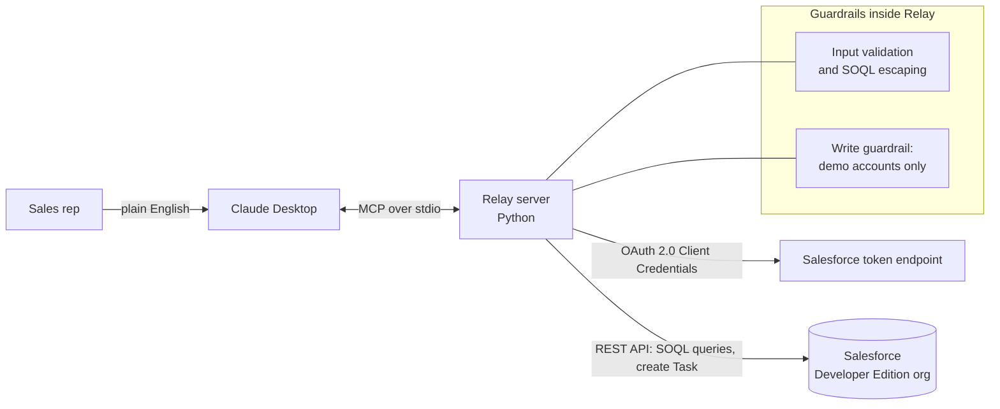

# Relay

An MCP server that connects Claude to a Salesforce org, so a sales rep can ask for account
context in plain English ("who should I call today, and what happened last time?") instead of
clicking through records.

Relay gives Claude **five tools**: four that read (account search, account briefing, open
pipeline, connection check) and one carefully fenced write (log a call note). It ships with a
seed script that fills a free Salesforce Developer Edition org with 50 fictional accounts, so
the whole thing can be tried safely.

> All data is fictional and generated by the seed script. Relay is an independent portfolio
> project. It is not affiliated with, endorsed by, or built from the data of any employer.

## How it works



1. You ask Claude something like *"Summarize the Brookside account before my call."*
2. Claude picks a Relay tool and calls it over MCP (local stdio, nothing is exposed to the network).
3. Relay validates the input, runs read-only SOQL against Salesforce, and returns tidy JSON.
4. Claude turns that into a short briefing, including flags such as "renewal in 38 days".

## Roadmap: web workspace (design in progress)

The five tools above are built and working. Next is a small web workspace on the same Salesforce
data: a dashboard of what to work today, a pipeline board by BDR status, and an account page with a
pre-call brief. The screenshot below is a **design mockup with sample data, not a working app yet**.


## Tools

| Tool | Reads or writes | What it does | Salesforce calls |
|---|---|---|---|
| `check_salesforce_connection` | Read | Org name and type, API calls left today, and any setup still missing (custom fields, deal stages). Run this first if anything fails. | `query` (Organization), `limits`, `describe` (Account, Opportunity) |
| `find_account` | Read | Search by part of the name and/or filter by BDR status, tier, portfolio type, unit range, or renewal window. Returns Ids and a `more_available` flag. Max 50 rows. | `query` (Account) |
| `summarize_account` | Read | One-call briefing: account details, contacts, open and past deals, recent call history, plus computed signals (renewal soon, long idle, re-engage date reached, open deal past close date, Active Opp with no open deal). | `query` x4 (Account, Contact, Opportunity, Task) |
| `list_open_deals` | Read | Open opportunities, soonest close date first, with a pipeline total and a per-stage breakdown. Optional account and stage filters. | `query` (Opportunity) |
| `log_note` | **Write** | Logs a completed Task (call or activity note) on an account, optionally tied to a contact. | `query` (Account, Contact), `sobjects/Task` create |

Read tools are marked `read_only_hint = true` and the write tool is marked non-destructive, so
Claude Desktop can ask for confirmation appropriately.

### Example prompts

- "Find my Tier 1 accounts that are renewing in the next 60 days."
- "Which accounts are Resting and ready to be re-engaged?"
- "Summarize the Maple Ridge account before my call."
- "What's in my open pipeline, by stage?"
- "Log a note on that account: spoke with the owner, wants a demo next week."

## Data model

Relay expects a standard Salesforce org plus a few custom fields on **Account** and three
custom **Opportunity** stages. `relay-check` tells you exactly what is missing.

| Account field | Type | Used for |
|---|---|---|
| `Units__c` | Number | Portfolio size, tier filter |
| `Portfolio_Type__c` | Picklist | Filtering |
| `Current_Software__c` | Text | Competitive context |
| `Contract_Renewal_Date__c` | Date | Renewal signals |
| `Account_Tier__c` | Picklist (1 to 4) | Prioritization |
| `BDR_Status__c` | Picklist (New, In Flow, Resting, Rehome, Active Opp) | Pipeline stage |
| `Re_engage_Date__c` | Date | Resting accounts |
| `Rehome_Reason__c` | Picklist | Why an account was rehomed |

Opportunity stages: Meeting Booked, Meeting Held, Demo (plus the built-in Closed Won / Closed Lost).

## Setup

You need a free [Salesforce Developer Edition](https://developer.salesforce.com/signup) org,
[uv](https://docs.astral.sh/uv/), and Claude Desktop.

### 1. Salesforce side (once)

1. Create the custom fields and stages from the data model above.
2. Setup > External Client App Manager > create an app, enable OAuth, tick **Client Credentials
   Flow**, and give it the `api` scope.
3. In the app's policies, set a **Run As** user (use a dedicated user, not your admin, if you can).
4. Copy the Consumer Key and Consumer Secret, and note your My Domain URL
   (Setup > My Domain, ends in `.my.salesforce.com`).

### 2. Local side (Windows, PowerShell)

```powershell
uv sync
Copy-Item .env.example .env      # then fill in the three Salesforce values
uv run relay-check               # should end with all [ok]
uv run pytest                    # 62 tests, no Salesforce needed
```

If `uv sync` fails with a hardlink error (os error 396), your project is probably inside
OneDrive. Move it out, or run `$env:UV_LINK_MODE = "copy"` first.

### 3. Load the fake data

```powershell
uv run relay-seed --dry-run      # shows what would be created, changes nothing
uv run relay-seed                # creates the demo data
```

| Option | What it does |
|---|---|
| `--dry-run` | Print the plan only |
| `--reset` | Delete existing demo data, then create fresh data |
| `--clean` | Delete demo data and stop |
| `--count N` | Number of accounts, 5 to 200 (default 50) |
| `--yes` | Skip the delete confirmation |
| `--allow-non-dev` | Override the Developer Edition check (not recommended) |

The seed is deterministic (fixed random seed), so everyone gets the same 50 accounts: 10 New,
15 In Flow, 8 Resting, 5 Rehome, 12 Active Opp, each with contacts and a call history. It
creates records through the sObject Collections endpoint in batches of 200.

### 4. Connect Claude Desktop

Settings > Developer > Edit Config, then add (use double backslashes on Windows):

```json
{
  "mcpServers": {
    "relay-crm": {
      "command": "uv",
      "args": ["--directory", "C:\\path\\to\\relay-crm-mcp", "run", "relay-server"]
    }
  }
}
```

Restart Claude Desktop completely, then ask: *"Check my Salesforce connection."*

## Security

- **Secrets stay local.** Credentials live only in `.env`, which is git-ignored. They are never
  printed, logged, or returned to Claude. The server logs to stderr only, because stdout carries
  the MCP protocol.
- **Injection-safe queries.** Every value that reaches SOQL is escaped, `LIKE` wildcards are
  escaped, Ids must match the 15 or 18 character Salesforce format, and picklist filters are
  checked against a whitelist.
- **One narrow write.** `log_note` can only create a Task. It refuses any account whose
  `AccountNumber` does not start with `RELAY-` (the seed script's marker), caps the subject at
  200 and the note at 4,000 characters, verifies that a given contact belongs to the account, and
  stamps every note "Logged via Relay (Claude)" so it is easy to audit.
- **Seed script safeguards.** It refuses to run in anything but a Developer Edition org unless
  you pass `--allow-non-dev`, only ever deletes records carrying the `RELAY-` marker, asks before
  deleting, and deletes children before parents.
- **Readable failures.** Expected problems (bad input, bad credentials, a refused write) come
  back as `{"ok": false, "error": "..."}` so Claude can tell you what to fix instead of showing
  a generic error.
- **For real use,** point the Run As user at a dedicated, low-permission Salesforce user so the
  API can only do what that user is allowed to do.

## Known limits

- Built and tested against a Developer Edition org with fictional data, not a production org.
- Single org, single user. There is no per-user OAuth login; all calls run as the Run As user.
- `find_account` and `list_open_deals` return at most 50 rows per call.
- The `RELAY-` write guardrail is deliberate. Using `log_note` on real accounts means changing
  that rule on purpose.
- Field names (`BDR_Status__c` and so on) are specific to this project's data model.
- Developer Edition orgs can be reclaimed after about 45 days of inactivity, so log in now and
  then if you want to keep yours.
- Tools never delete or edit existing records. The only deletes are inside the seed script.

## Project structure

```
src/relay/
  server.py         MCP server: tool registration, error handling
  tools.py          Tool logic (validation, SOQL, signals); takes any client with query()/create()
  salesforce.py     Salesforce client: OAuth, retry on expired session, batch create/delete
  seed.py           relay-seed command
  seed_data.py      Deterministic fake data generator
  check_connection.py   relay-check command
  config.py         .env loading and validation
  constants.py      Shared picklist values and field names
tests/              62 tests: logic, seed script, client, and the real server over stdio
```

## Development

```powershell
uv run pytest        # tests
uv run ruff check .  # lint
```

The tests use in-memory fakes of Salesforce, so they run offline and never touch a real org.
One test starts the real server as a subprocess and talks to it over stdio the same way Claude
Desktop does.

## License

MIT
